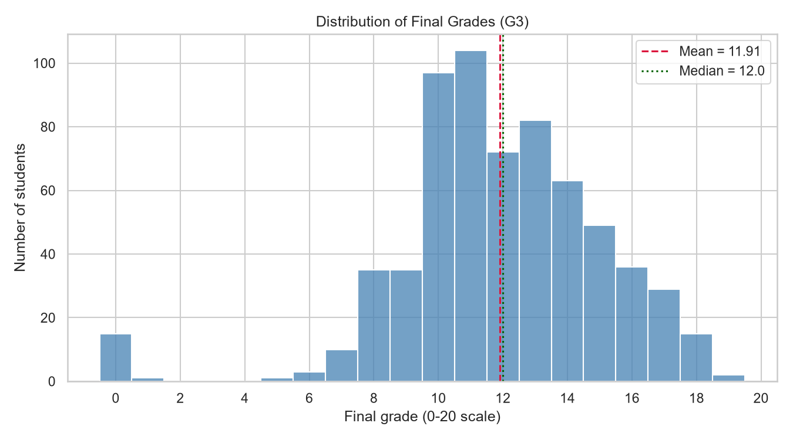
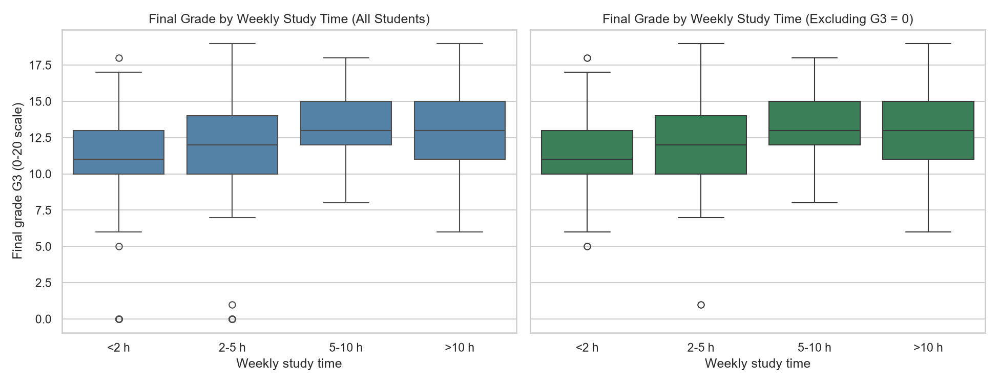
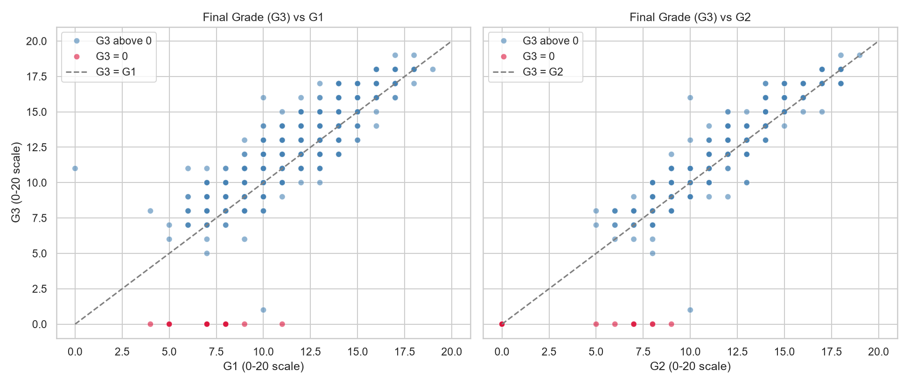
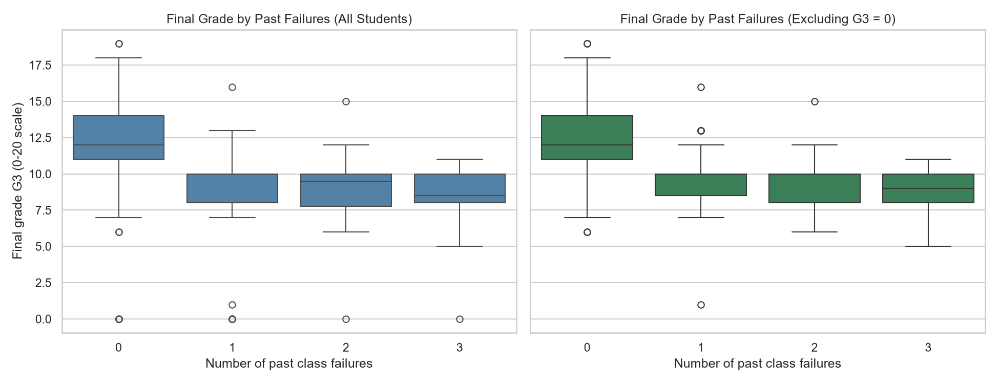
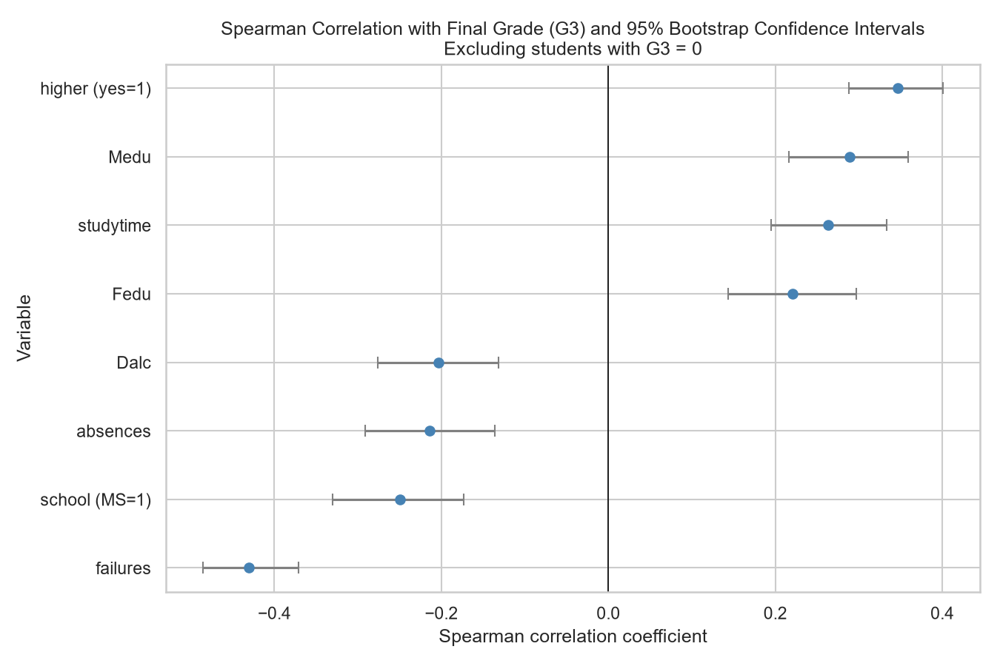
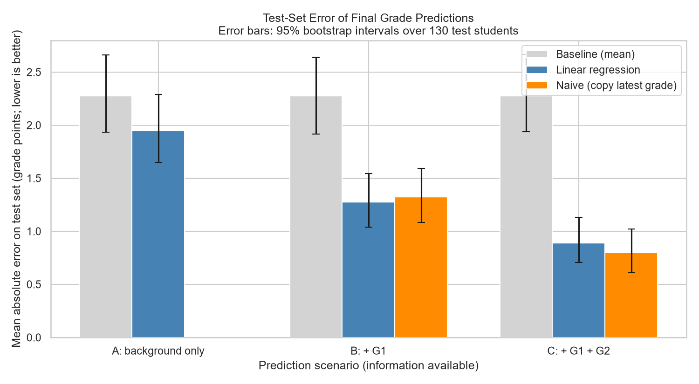

# Student Performance Analysis

**Exploring the factors associated with academic achievement in secondary school students**

An end-to-end data science project in Python: data cleaning, exploratory analysis, statistical testing and machine learning on a real, public dataset of 649 Portuguese secondary school students.

> **Short version:** earlier grades are by far the strongest predictor of the final grade. Among other factors, past class failures show the strongest relationship, but a model using background information alone is only modestly better than guessing the average. All findings are associations, not proof of cause. The full write-up is in [REPORT.md](REPORT.md).

## Problem statement

Which student characteristics are associated with final academic achievement, and how well can the final grade be predicted from information available at different points in the school year?

## Objectives

1. Clean and validate a real student performance dataset, documenting every issue found.
2. Explore how study time, past failures, previous grades and student characteristics relate to the final grade.
3. Test whether the observed differences are larger than chance, and discuss correlation versus causation.
4. Build and honestly evaluate a regression model, with a baseline, cross-validation and leakage checks.
5. Report findings and limitations without overstating the results.

## Dataset

- **Source:** [Student Performance](https://archive.ics.uci.edu/dataset/320/student+performance), UCI Machine Learning Repository (dataset ID 320).
- **File used:** `student-por.csv` (Portuguese-language course): 649 students, 33 variables, from two Portuguese schools.
- **Licence:** [Creative Commons Attribution 4.0 (CC BY 4.0)](https://creativecommons.org/licenses/by/4.0/).
- **Citation:** P. Cortez and A. Silva. *Using Data Mining to Predict Secondary School Student Performance.* Proceedings of the 5th FUture BUsiness TEChnology Conference (FUBUTEC 2008), pp. 5-12, Porto, Portugal, 2008.
- **Target:** `G3`, the final grade (0-20).
- **Note on attendance:** the dataset has no attendance rate, only `absences` (a count of absences).

See [data/README.md](data/README.md) for details.

## Tools and technologies

Python 3.11, pandas, NumPy, Matplotlib, Seaborn, SciPy, scikit-learn, Git and GitHub. Exact versions are pinned in `requirements.txt`.

## Project structure

```
student-performance-analysis/
├── data/
│   ├── README.md              Source, licence and citation
│   └── student-por.csv        Original dataset (unmodified)
├── images/                    Charts produced by the scripts
├── src/
│   ├── load_data.py, inspect_data.py, check_quality.py,
│   │   investigate_zeros.py    Data loading and quality checks
│   ├── clean_data.py           Creates the cleaned dataset
│   ├── eda_01 ... eda_05       Exploratory data analysis
│   ├── stat_01 ... stat_04     Statistical analysis
│   ├── ml_common.py            Shared helpers for the ML scripts
│   ├── ml_01 ... ml_07         Machine learning
│   └── check_setup.py          Checks the environment
├── REPORT.md                  Full findings report
├── README.md
├── requirements.txt
└── .gitignore
```

## Methodology

1. **Data cleaning.** Checked data types, missing values (none), duplicates (none) and value ranges. Found 15 students with a final grade of 0 and kept them, flagged with a `g3_zero` column. The raw file is never modified.
2. **Exploratory analysis.** Distributions, group comparisons and Spearman correlations, repeated with and without the zero-grade students.
3. **Statistical analysis.** Normality checks, rank-based tests (Mann-Whitney U, Kruskal-Wallis) with Holm correction for multiple tests, effect sizes, bootstrap confidence intervals, and a subgroup check for confounding.
4. **Machine learning.** Regression on `G3` in three scenarios: background information only, plus `G1`, plus `G1` and `G2`. Models: a mean baseline, linear regression and random forest. Evaluation used an 80/20 split, repeated 5-fold cross-validation, error analysis, permutation importance, and a final test-set evaluation with bootstrap intervals.
5. **Leakage and fairness of comparison.** `g3_zero` is derived from the target and is never used as a feature. `absences` was dropped from the final model because its timing is unknown. For the scenarios using earlier grades, the model is compared with a naive rule that copies the latest grade.

## Visualisations

| | |
|---|---|
|  |  |
|  |  |
|  |  |

All charts are in [`images/`](images/).

## Findings

All numbers below are from the analyses in this repository. Grade statistics exclude the 15 zero-grade students unless stated.

**Patterns in the data**
- The mean final grade is 11.91 and the median is 12 (out of 20). The 15 zero grades (14 from school MS, all with 0 absences) cause most of the left skew.
- Earlier grades track the final grade very closely (Spearman rho 0.88 for `G1`, 0.94 for `G2`). For 89.9% of students the final grade is within 1 point of `G2`.
- Weekly study time is positively related to the final grade (rho 0.26): mean 11.27 for under 2 hours, 12.38 for 2-5 hours and 13.23 for 5-10 hours.
- Past failures show the strongest relationship among non-grade variables (rho -0.43): students with no past failures average 12.65, versus 9.60 for one failure.
- Students who want to pursue higher education average 12.49, versus 9.48 for those who do not (a large effect).

**Statistical results**
- After correcting for 13 tests, five group differences remained significant: wanting higher education (large), school (medium), and home address, internet access and sex (all small).
- Bootstrap 95% intervals for the main correlations exclude zero, but the middle-ranked variables overlap, so their exact order is not reliable.
- The study-time relationship stayed positive within each school, each sex and each higher-education group, but was close to zero among the 91 students with past failures.

**Machine learning (test set of 130 students, mean absolute error in grade points)**

| Information available | Mean baseline | Linear regression | Copy latest grade |
|---|---|---|---|
| Background only | 2.28 | 1.95 | n/a |
| + `G1` | 2.28 | 1.28 | 1.32 |
| + `G1` + `G2` | 2.28 | 0.89 | 0.80 |

- With background information only, the model lowered the error by about 14% compared with the baseline (R-squared 0.24). A typical prediction is still about 2 points off.
- Once earlier grades are known, the model is statistically indistinguishable from simply copying the latest grade.
- The model cannot identify students who receive a zero, and its predictions are pulled toward the middle of the grade range.

Full details, tables and caveats are in [REPORT.md](REPORT.md).

## How to run

You need Python 3.10 or newer and Git.

```bash
# 1. Get the code
git clone https://github.com/Anopa21/student-performance-analysis.git
cd student-performance-analysis

# 2. Create and activate a virtual environment
python -m venv .venv
# Windows (PowerShell):  .venv\Scripts\activate
# macOS / Linux:         source .venv/bin/activate

# 3. Install the libraries
pip install -r requirements.txt

# 4. Create the cleaned dataset (required before most other scripts)
python src/clean_data.py
```

Then run the scripts from the project root, in this order. Each prints its results and saves its charts to `images/`:

```bash
python src/eda_01_grade_distribution.py
python src/eda_02_studytime.py
python src/eda_03_previous_grades_failures.py
python src/eda_04_group_differences.py
python src/eda_05_correlations.py
python src/stat_01_normality.py
python src/stat_02_group_tests.py
python src/stat_03_confidence_intervals.py
python src/stat_04_confounding_check.py
python src/ml_01_split_and_baseline.py
python src/ml_02_first_models.py
python src/ml_03_cross_validation.py
python src/ml_04_sensitivity.py
python src/ml_05_error_analysis.py
python src/ml_06_feature_importance.py
python src/ml_07_final_evaluation.py
```

On Windows PowerShell, if activating the environment is blocked, run `Set-ExecutionPolicy -Scope Process -ExecutionPolicy Bypass` first. The cross-validation and feature-importance scripts can take a minute or two. Random seeds are fixed, so results should be repeatable.

## Limitations

- Small, narrow sample: 649 students from two schools in one country, one subject, one school year. Results may not generalise.
- Observational survey data: the findings are associations, not causes, and several variables overlap (for example, the two schools differ in study habits and past failures).
- Self-reported variables such as study time and alcohol use may be inaccurate.
- The meaning of the 15 zero grades is not documented.
- The documented coding of `failures` does not match the values in the file, and the timing of `absences` is unknown.
- Models used default settings with no tuning, and the test set has only 130 students, so scores are noisy.
- Background-only predictions are not accurate enough to make decisions about individual students.

## Future improvements

- Run the same analysis on the Mathematics file and compare the two subjects.
- Tune the models and try additional model types, with nested cross-validation.
- Treat "final grade of 0" as a separate classification problem.
- Account for the clustering of students within schools.
- Add a notebook that walks through the analysis step by step.

## Data licence and attribution

The dataset is © its authors and is used under CC BY 4.0. Please cite Cortez and Silva (2008) if you reuse it.

## Author

Anopa Machipisa · [GitHub: Anopa21](https://github.com/Anopa21)