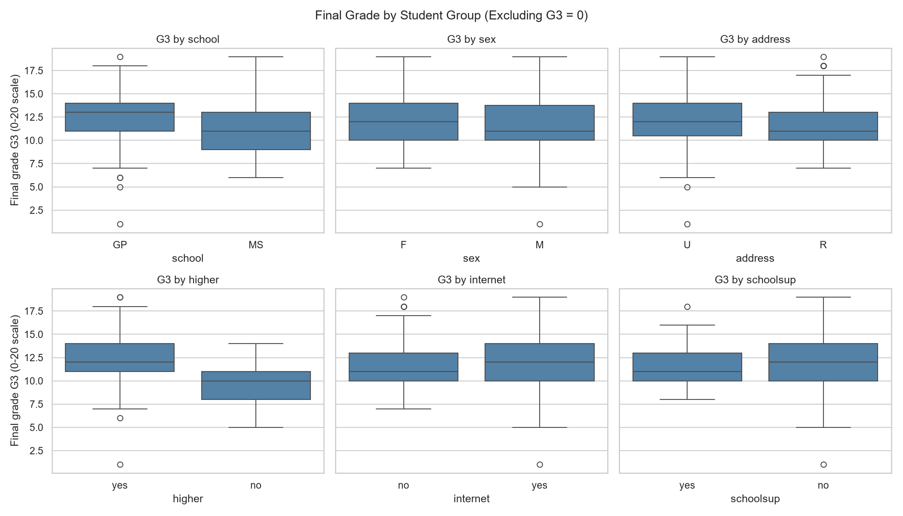
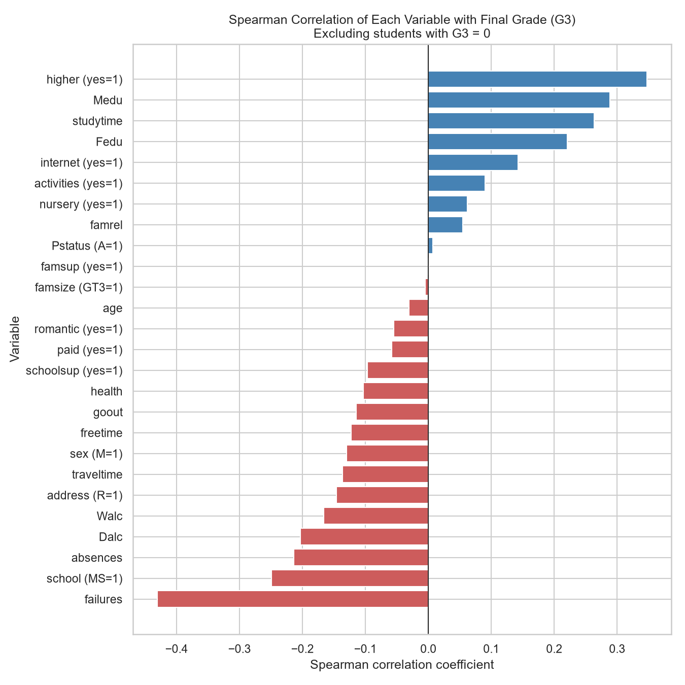
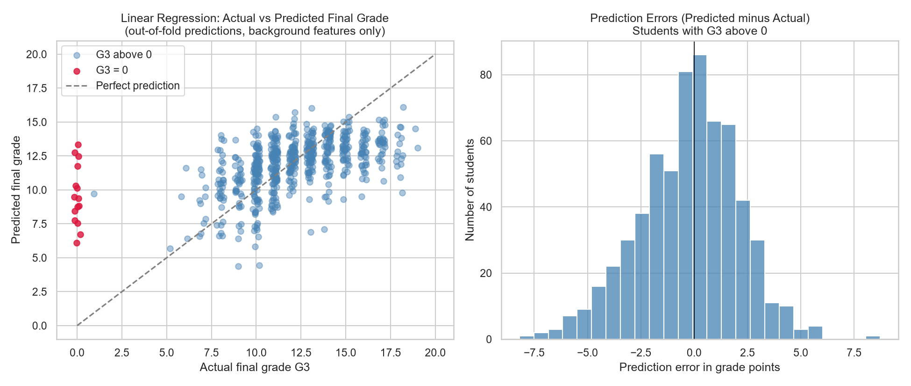
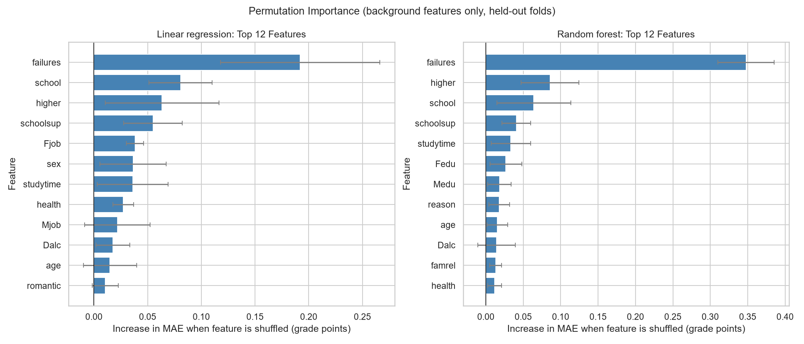

# Student Performance Analysis: Findings Report

## 1. Summary

This project analysed 649 secondary school students from two Portuguese schools (Portuguese-language course) to explore which factors are associated with the final grade (`G3`, scored 0-20).

- The typical final grade is about 12 out of 20 (mean 11.91, median 12).
- Earlier grades are very strongly related to the final grade (Spearman rho 0.88 for `G1`, 0.94 for `G2`).
- Among the other variables, past class failures show the strongest relationship with the final grade (rho = -0.43). Wanting to pursue higher education, mother's education, weekly study time, school, and father's education come next, all with weaker relationships (rho between 0.22 and 0.35 in size).
- A linear regression using only background information reduced prediction error by about 14% compared with always predicting the average grade, but a typical prediction is still about 2 grade points off.
- Once earlier grades are available, the model performed no better than simply copying the most recent grade.
- All findings are associations in survey data. They do not show that any factor causes a change in grades.

## 2. Data

**Source:** UCI Machine Learning Repository, "Student Performance" (dataset ID 320), file `student-por.csv`. Licence: CC BY 4.0.
**Citation:** P. Cortez and A. Silva. *Using Data Mining to Predict Secondary School Student Performance.* Proceedings of the 5th FUture BUsiness TEChnology Conference (FUBUTEC 2008), pp. 5-12, Porto, Portugal.

**Size:** 649 students and 33 variables (17 text, 16 integer). School GP has 423 students and school MS has 226.

**Attendance:** the dataset has no attendance rate. It has `absences`, a count of school absences, which is analysed as absences.

**Data quality checks:**
- No missing values and no duplicated rows.
- All numeric values were within their documented ranges. No grade of 20 appears (the maximum is 19).
- The documentation says `failures` takes the values 1, 2 or 4, but the file contains 0, 1, 2 and 3. It was treated as an ordered code from 0 to 3, and the meaning of the top value was not assumed.

**Students with a final grade of 0:** 15 students (2.3%) have `G3 = 0`. Of these, 14 are from school MS, all 15 have exactly 0 absences (compared with 36.1% of all other students), and all 7 students with `G2 = 0` also have `G3 = 0`. The reason is not documented, so these records were flagged with a `g3_zero` column and kept in the data. Most analyses were run both with and without them.

## 3. Exploratory findings

**Grade distribution.** `G3` has mean 11.91, median 12 and standard deviation 3.23. The 15 zero grades form a separate cluster far from the rest and cause most of the left skew (skew -0.91 with them, 0.13 without). Without the zeros the mean rises to 12.19.

**Study time.** Higher weekly study time goes with higher final grades (students excluding zero grades):

| Weekly study time | Students | Mean G3 |
|---|---|---|
| Under 2 hours | 204 | 11.27 |
| 2 to 5 hours | 298 | 12.38 |
| 5 to 10 hours | 97 | 13.23 |
| Over 10 hours | 35 | 13.06 |

The Spearman correlation is 0.26 (0.27 with all students). The pattern levels off at the top, but the over-10-hours group is small.

**Previous grades.** `G1` and `G2` track `G3` closely (see the scatter plots in `images/03_previous_grades_vs_g3.png`). Among students with a non-zero final grade, `G3` was within 1 point of `G2` for 89.9% of them, and the average change from `G2` to `G3` was +0.43 points.

**Past failures.** Students with no past failures averaged 12.65 on `G3` (543 students, excluding zeros), compared with 9.60 for one failure (63), 9.40 for two (15) and 8.69 for the highest code (13). The largest gap is between no failures and any failures.

**Group differences** (mean G3 excluding zero grades):

| Variable | Higher-scoring group | Lower-scoring group | Gap |
|---|---|---|---|
| Wants higher education | yes (12.49) | no (9.48) | 3.01 |
| School | GP (12.61) | MS (11.35) | 1.25 |
| Extra school support | no (12.28) | yes (11.45) | 0.83 |
| Internet at home | yes (12.37) | no (11.56) | 0.81 |
| Sex | F (12.48) | M (11.76) | 0.72 |
| Home address | urban (12.40) | rural (11.68) | 0.72 |

Family educational support, family size and parents' cohabitation status showed gaps of 0.10 or less.

**Strongest relationships.** Excluding the earlier grades, the variables with the largest Spearman correlations with `G3` (excluding zero grades) were: past failures (-0.43), wants higher education (+0.35), mother's education (+0.29), study time (+0.26), school MS (-0.25), father's education (+0.22), absences (-0.21) and weekday alcohol use (-0.20). Mother's and father's education are strongly related to each other (0.65), so their separate effects cannot be told apart.

## 4. Statistical results

- **Normality:** without the zero grades `G3` is close to a bell shape (skew 0.13), but the Shapiro-Wilk test still rejects exact normality (p = 1.6e-08), so rank-based tests were used.
- **Two-group tests** (Mann-Whitney U, Holm-corrected for 13 tests): five differences remained significant: wants higher education (large effect, rank-biserial 0.66), school (medium, 0.30), home address (small, 0.18), internet access (small, 0.20) and sex (small, 0.15). Extra school support and extracurricular activities had raw p-values below 0.05 but were not significant after correction. The other six variables showed no significant difference.
- **Multi-group tests** (Kruskal-Wallis): both study time (epsilon-squared 0.072) and past failures (0.186) differ significantly across their groups.
- **Confidence intervals** (bootstrap, 2,000 resamples): all of the main correlations had 95% intervals that exclude zero. For example, past failures -0.49 to -0.37, wants higher education 0.29 to 0.40, study time 0.20 to 0.33. Intervals for the middle-ranked variables overlap, so their exact order is not reliable.
- **Subgroup check:** the study-time relationship stayed positive within each school, each sex, and each higher-education group (rho 0.16 to 0.26). It was essentially zero (0.016) among the 91 students with past failures, which is a small group and an open question. School MS has more students reporting under 2 hours of study (40.6% vs 28.0%) and more with past failures (21.2% vs 10.9%), so part of the school gap may be linked to these differences.

## 5. Machine learning

**Goal:** predict the final grade `G3` (regression). The data was split 80/20 (519 training and 130 test students), stratified so zero-grade students were spread across both sets.

**Scenarios:** (A) background information only, (B) background plus `G1`, (C) background plus `G1` and `G2`. The variable `g3_zero` was never used as a feature, because it is derived from the target. `absences` was dropped from the final model because its timing is unknown and removing it changed cross-validated results by 0.005 grade points or less.

**Models:** a baseline that always predicts the mean, linear regression, and a random forest (default settings, no tuning). Scenarios B and C were also compared with a naive rule that copies the latest earlier grade.

**Cross-validation** (5 folds, repeated 3 times; mean absolute error in grade points; with `absences`):

| Scenario | Baseline | Linear regression | Random forest | Naive copy rule |
|---|---|---|---|---|
| A: background only | 2.41 | 2.01 | 2.02 | n/a |
| B: + G1 | 2.41 | 1.24 | 1.23 | 1.25 |
| C: + G1 + G2 | 2.41 | 0.83 | 0.83 | 0.77 |

The random forest fitted the training data much more closely than held-out data (training MAE 0.74 vs validation 2.02 in scenario A), but gained nothing on held-out students. The simpler linear regression was therefore chosen.

**Final test-set results** (130 students; linear regression without `absences`; 95% bootstrap interval in brackets):

| Scenario | Model | MAE | R-squared |
|---|---|---|---|
| A: background only | Baseline (mean) | 2.28 [1.93, 2.66] | -0.003 |
| A | Linear regression | 1.95 [1.65, 2.29] | 0.24 |
| B: + G1 | Linear regression | 1.28 [1.04, 1.54] | 0.62 |
| B | Naive: G3 = G1 | 1.32 [1.09, 1.59] | 0.59 |
| C: + G1 + G2 | Linear regression | 0.89 [0.71, 1.13] | 0.77 |
| C | Naive: G3 = G2 | 0.80 [0.61, 1.02] | 0.78 |

- With background information only, the model's error was 0.33 grade points lower than the baseline (95% interval -0.59 to -0.07).
- With earlier grades, the model's advantage over copying the latest grade was not distinguishable from chance (B: -0.05, interval -0.18 to +0.08; C: +0.09, interval -0.00 to +0.18).

**Where the model fails** (out-of-fold predictions for all 649 students, background features only):
- The 15 zero-grade students were predicted at about 9.6 on average, so the model cannot identify them. They account for about 11% of the total absolute error.
- Only about 36% of students with a non-zero grade were predicted within 1 grade point, and about 63% within 2.
- Predictions are pulled toward the middle: weak students (actual grade 1 to 9) were over-predicted by 1.84 points on average, and strong students (15 to 20) were under-predicted by 3.06 points.

**Features the models relied on** (permutation importance on held-out folds): past failures clearly ranked first in both models. Wanting higher education, school, extra school support and study time followed, with no reliable order among them.

## 6. Suggestions supported by the findings

These are ideas for further investigation. The data cannot show that acting on them would change grades.

1. **Treat past failures as an early signal.** Past failures were the strongest background variable in both the statistics and the models (rho -0.43, a gap of about 3 grade points between no failures and any failures). A school could use it to decide which students to check in with early, as a flag for a conversation and not as a label.
2. **Monitor the most recent grade.** For most students the final grade stays close to the second-period grade (89.9% within 1 point), and a copy rule matched the trained model. A simple rule that flags students with low current grades is as good as this model and much easier to explain and maintain.
3. **Investigate the zero-grade records.** All 15 have no recorded absences and 14 are from one school. Finding out whether they are withdrawals, missed exams or recording problems, and recording them consistently, would improve any future analysis.
4. **Study habits and aspirations deserve a closer look.** Study time and the wish to continue to higher education are associated with higher grades, and the study-time pattern held in most subgroups. A pilot that is evaluated carefully would be needed to learn whether encouraging either changes outcomes.
5. **Do not conclude that support or tutoring lowers grades.** Students receiving extra school support or paid classes had lower average grades, but this probably reflects who receives help. The data cannot separate the two explanations.

## 7. Limitations

- **Small, narrow sample:** 649 students from two schools in one country, one subject, one school year. The results may not apply elsewhere.
- **Association, not causation:** this is observational survey data. Confounding is visible (for example, the two schools differ in study habits and past failures), and only a few possible confounders were checked.
- **Self-reported variables:** study time, alcohol use and other questionnaire answers may be inaccurate.
- **Zero grades are unexplained.** Results were reported with and without them, but their true meaning is unknown.
- **Documentation mismatch:** the documented coding of `failures` does not match the data.
- **Timing unknown:** the dataset does not say when `absences` and the questionnaire answers were recorded, so a mild timing leak cannot be fully excluded for early-year predictions.
- **Model scope:** default settings with no tuning, only two model types, and a test set of 130 students, so scores are noisy.
- **Modest predictive power from background alone:** R-squared of about 0.24 on the test set and a typical error of about 2 grade points. The model is not accurate enough to make decisions about individual students.
- **Multiple comparisons:** many variables were examined. Holm correction was applied to the group tests, but the exploratory correlations were not corrected.

## 8. Reproducibility

All scripts are in `src/` and were run in numbered order: data checks (`check_*.py`, `load_data.py`, `inspect_data.py`, `investigate_zeros.py`, `clean_data.py`), exploratory analysis (`eda_01` to `eda_05`), statistics (`stat_01` to `stat_04`), and machine learning (`ml_common.py`, `ml_01` to `ml_07`). Random seeds are fixed (42) so results are repeatable. Charts are saved in `images/`.